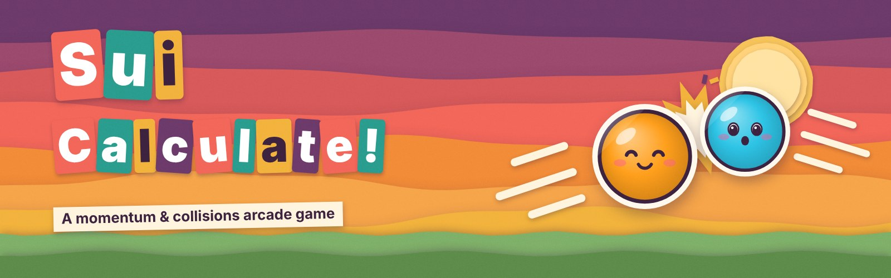

# SuiCalculate

**A papercraft physics game about momentum and collisions.** Fling sticker faces from a popsicle-stick catapult into a paper display box. Crash matching faces together hard enough and they merge into a bigger, heavier face. Let one fall out of the box and the game is over.

### ▶ [Play it in your browser](https://acs-rll.github.io/suicalculate/)

Works on phones and laptops. On a phone you can also add it to your home screen (Share → Add to Home Screen on iPhone, or Install app on Android) and play it offline.

---

## How to play

1. **Drag back anywhere and let go** to fling the face. The dotted guide shows where it will land.
2. **Crash matching faces together hard** to merge them. A soft bump just makes them sit together.
3. **Don't let a face fall out of the box.**

Extras: shake the box when the bottom gets stuck, earn power-ups (Anvil, Bouncy, Blast) with a ×3 combo, smash the 12 kg textbooks that drop in, and watch out for wind and a moving catapult as your score grows.

## The physics

| Idea | In the game |
|---|---|
| Momentum, **p = mv** | Each tier doubles the mass (1 kg up to 512 kg). Heavier and faster faces carry more momentum and score more. |
| Elastic collision (C2) | Different faces bounce off each other. Momentum **and** kinetic energy are kept. |
| Perfectly inelastic collision (C1) | Matching faces stick together: **v′ = (m₁v₁ + m₂v₂) ÷ (m₁ + m₂)**. Momentum is kept, kinetic energy is lost. |
| Merge rule | A merge needs enough kinetic energy lost: **KE lost = ½μv²**, with **μ = m₁m₂ ÷ (m₁ + m₂)** (4 J Easy, 9 J Normal, 16 J Hard). |
| Impulse, **J = Δp = FΔt** | The box shake and the Blast power-up push faces; textbooks only break from a big enough Δp. |
| Newton's second law, **a = F ÷ m** | Wind pushes light faces more than heavy ones. The box shelters faces from the wind. |
| Projectile motion | Every shot falls under **g = 10 m/s²**; walls and the ground return half the speed (e = 0.5). |

The **Physics lab** (Lab button) has a Test mode that runs controlled collisions, a data log you can download as CSV, and the full explanation of every rule.

## Made by

General Physics 1 · Performance Task 2.1 · *Collision Arcade: Design-a-Game Challenge* · Mr. Ignacio Luigi B. de la Rama

| Member | Role |
|---|---|
| Lustado | Project Manager |
| Zaraspe | Physics Lead |
| Palomares | Game Designer |
| Acuesta | Programmer |

Built with HTML, CSS and JavaScript (canvas), with a custom physics engine, and developed with help from Claude (Anthropic).

## Downloads

- [Poster, A4 (PDF)](assets/poster-a4.pdf) · [A4 (image)](assets/poster-a4.jpg)
- [Poster, 16:9 slide](assets/poster-16x9.png)

## Versions

The current version is shown in the game under **Lab → Physics** (scroll to the bottom).

- **v2.4**: new app icon, splash screen with physics tips, link preview image, posters
- **v2.3**: wind sock beside the catapult
- **v2.2**: papercraft campus at golden hour
- **v2.1**: school campus at night, power-ups, wind, moving catapult
- **v2.0**: slingshot outside an open box; a face falling out ends the game
- **v1.x**: the original tank version with the danger line
